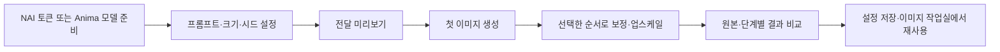

# 이미지 생성 따라하기 — 한국어

[README](../README.md) · [English](IMAGE_GENERATION_EN.md) · [日本語](IMAGE_GENERATION_JA.md) · [전체 사용 가이드](USER_GUIDE_KO.md)

이 가이드는 현재 생성 화면을 기준으로 **설치 → 토큰/모델 준비 → 한 장 생성 → 다른 엔진으로 보정 → 비교·저장 → 유사사례 재사용**을 설명합니다. 화면 상단 **앱 언어**를 한국어로 설정하면 아래 버튼 이름과 맞습니다. 프롬프트 원문과 생성 조건은 언어 전환으로 바뀌지 않습니다.



## 1. 사용할 경로 고르기

| 목적 | 준비할 것 |
|---|---|
| NAI로 한 장 생성 | 인터넷, 사용 가능한 NovelAI 계정/토큰. Anima 모델은 필요 없음 |
| Anima로 한 장 생성 | 로컬 Anima 체크포인트·텍스트 인코더·VAE와 호환 GPU 런타임 |
| NAI 생성 → Anima 디테일러 | 위 두 가지 + 얼굴 검출 모델·선택 의존성 |
| Anima 생성 → NAI 디테일러 | 위 두 가지 + 로컬 검출 모델·선택 의존성 |

NAI 모델은 원격 서비스에서 실행됩니다. Anima 모델이나 LoRA를 NAI 생성 모델로 업로드하는 기능은 아닙니다. NAI로 디테일링할 때에도 영역 검출은 로컬에서 이루어집니다.

## 2. 설치와 실행

Python 3.10 이상을 사용합니다. 저장소 전체를 받거나 source-checkout 압축을 풀고 그 루트에서 실행합니다. 일반 wheel에는 루트의 로컬 생성 런타임이 포함되지 않습니다. GPU 종류에 맞는 PyTorch 환경은 별도로 확인하세요.

Linux / Bash:

```bash
python3 -m venv .venv
source .venv/bin/activate
python -m pip install --upgrade pip
python -m pip install -e .
python -m anima_app.cli serve --host 127.0.0.1 --port 8768 --open
```

Windows PowerShell:

```powershell
py -m venv .venv
.\.venv\Scripts\Activate.ps1
python -m pip install --upgrade pip
python -m pip install -e .
python -m anima_app.cli serve --host 127.0.0.1 --port 8768 --open
```

NAI를 쓸 경우 **서버 실행 전에** [토큰 설정 안내](NAI_TOKEN_SETUP.md)를 따릅니다. **웹 화면에는 NAI 토큰 입력칸이 없습니다.** 앱을 시작하는 터미널의 숨김 입력으로 `NAI_ACCESS_TOKEN`을 설정합니다. 실행 후 **생성 엔진 → NovelAI** 아래의 상태와 `/api/nai/status`에서 설정 여부를 확인합니다. 토큰을 바꾸면 서버를 다시 시작해야 합니다.

같은 브라우저에서 초안과 언어 설정을 유지하려면 같은 주소·포트를 사용하세요. 포트 충돌 시 실행 중인 서버를 확인하고 다른 포트를 골라야 합니다. `--port 0`은 사용 가능한 포트를 자동 선택하지만 주소가 바뀌면 브라우저 저장 초안이 보이지 않을 수 있습니다.

### Anima와 디테일러 모델 준비

앱 서버가 실행되지 않은 터미널에서 같은 가상환경을 활성화하고 필요한 명령을 실행합니다. 아래 명령은 다운로드를 명시하므로 모델 크기에 맞는 디스크 공간이 필요합니다.

```bash
python -m anima_app.cli models copy-profile anima-t2i --source download
python -m anima_app.cli models copy-profile anima-aesthetic-v1.1 --source download
python -m pip install -e '.[face-detailer]'
python -m anima_app.cli models copy-profile face-detailer-detectors --source download
python -m anima_app.cli health --json
```

첫 명령은 Base와 공유 텍스트 인코더·VAE, 두 번째는 선택 Aesthetic 체크포인트를 준비합니다. 마지막 두 준비 명령은 디테일러를 쓸 때 필요합니다. 이미 모델이 있다면 [로컬 모델 원본 사용](USER_GUIDE_KO.md#22-로컬-모델-원본-사용)을 따릅니다. 체크포인트 파일 하나만 넣고 인코더/VAE를 생략하면 Anima 생성과 디테일러가 준비되지 않습니다.

## 3. 화면 읽기

| 위치 | 하는 일 |
|---|---|
| 상단 | 생성/이미지 작업실 이동, 앱 언어, 최근 결과 접기 |
| 왼쪽 | 생성 엔진, 프롬프트, 이미지 크기, 작업 순서, 모델·캐릭터·스타일, 참조·후처리 |
| 가운데 | 최종 이미지, 확대, 단계 비교, 사용 조건과 참고 사례 |
| 오른쪽 | 최근 결과와 이전 조건 불러오기 |
| 하단 고정 바 | 생성하기, 정지, 연속 생성 설정, 현재 진행 상태 |

**모델 · 캐릭터 · 스타일**, **참조 이미지 · 후처리**, **프리셋 · 앱 설정**은 접힌 패널을 펼쳐 사용합니다. 모바일에서는 여러 영역이 세로로 쌓입니다.

## 4. NAI로 첫 이미지 만들기

1. **생성 엔진**에서 **NovelAI**를 선택합니다. 토큰 상태 안내가 설정됨인지 확인합니다.
2. **작업 순서 → 생성만**으로 추가 후처리를 비웁니다. **참조 이미지 · 후처리**의 기존 디테일러도 꺼져 있는지 확인합니다. `생성만`은 기존 패널의 기능까지 모두 끄는 버튼은 아닙니다.
3. **모델 · 캐릭터 · 스타일**을 펼치고 NAI 생성 방식을 **T2I**, 모델을 **V4.5 Full**로 선택합니다. 아래 예시는 이 모델 기준입니다.
4. **그리고 싶은 장면**에 예시 프롬프트를 넣습니다. 처음에는 캐릭터 슬롯·Vibe·Precise Reference·와일드카드 없이 동작을 확인하면 원인을 구분하기 쉽습니다.

```text
1girl, adult woman, short brown hair, brown eyes, hairclip,
white blouse, portrait, garden, soft daylight, detailed eyes
```

네거티브 예시:

```text
blurry, low quality, extra fingers, text, watermark
```

5. 크기 **768×1024**, 스텝 **28**, CFG **6**, 샘플러 **Euler Ancestral**, 시드 **12345**, 수량 **1장**으로 시작합니다. 이는 비교용 출발점이며 모든 모델의 최적값이 아닙니다. Medium Effort를 선택하면 14스텝 등 고정 조건이 적용되므로 화면의 실제 조건을 따르세요.
6. **Opus 무료 범위 보호**는 기본값을 유지하고 유효 조건 안내를 확인합니다. 자격/조건이 맞지 않아 차단되면 오류 원인을 읽습니다. 참조·Img2Img 등의 작업을 사용하려고 보호를 해제하면 비용이 발생할 수 있습니다. 보호 통과가 실제 청구 내역을 증명하지는 않습니다.
7. **단계별 전달 미리보기**를 열어 NAI에 전달될 양성/음성 프롬프트를 확인합니다. 이것만으로 이미지가 생성되지는 않습니다.
8. **생성하기**를 한 번 누릅니다. 대기/진행 표시를 확인하고 완료되면 가운데 이미지를 봅니다. 원격 처리 중 정지해도 이미 보낸 요청의 처리나 비용은 되돌릴 수 없습니다.
9. 오른쪽 최근 결과에서 방금 결과를 선택하고 모델·시드·프롬프트를 확인합니다. 같은 시드로 한 조건만 바꿔 다시 생성하면 차이를 비교하기 쉽습니다. 서로 다른 모델/버전에서 같은 시드는 같은 이미지를 보장하지 않습니다.

## 5. Anima로 첫 이미지 만들기

1. **생성 엔진 → 로컬 Anima**를 선택합니다.
2. **모델 · 캐릭터 · 스타일**에서 준비된 체크포인트를 선택하고 런타임 준비 상태를 확인합니다. Aesthetic v1.1이 준비됐으면 사용할 수 있습니다.
3. 위의 장면 프롬프트를 입력합니다. Anima의 기본값 **832×1216 / 20스텝 / CFG 3.5 / euler_ancestral_cfg_pp / sgm_uniform**을 출발점으로 사용합니다.
4. 작업 순서와 기존 후처리 패널에서 업스케일·디테일러가 꺼져 있는지 확인하고 한 장을 생성합니다. 메모리가 부족하면 크기/후처리를 줄이거나 VRAM 프로필을 조정합니다.
5. 한 장 생성이 성공하면 다음 절의 디테일러를 붙입니다. 첫 모델 로드와 다음 생성의 소요 시간은 다를 수 있습니다.

## 6. 작가 표기와 가중치

입력 프롬프트 표기는 기본 **자동 감지**입니다. 예를 들어 `(artist:example_artist:0.9), soft light`는 NAI V4/V5에서 `0.9::artist:example_artist ::, soft light`, Anima에서 `(@example_artist:0.9), soft light`로 전달됩니다. `example_artist`는 설명용 이름입니다.

- `artist:`나 `@`가 있으면 명시적인 작가로 처리합니다.
- 접두사가 없으면 로컬 작가 목록과 **태그 전체가 정확히 일치할 때만** 작가로 인식합니다. 목록은 배포본에 포함되지 않습니다.
- 묶음 가중치·작가 순서·괄호 이스케이프를 보존합니다. 모호한 표기는 원본 문법을 직접 선택하고 미리보기를 확인합니다.
- 원문은 작성창에 남습니다. NAI V3 가중치는 근사 변환이며 경고를 확인해야 합니다.

선택적으로 작가 태그 목록을 준비할 수 있습니다. 이미지나 토큰은 조회에 보내지 않습니다.

```bash
python scripts/update_artist_catalog.py --pages 20 --interval 2
```

기본 조회는 일부 활성 태그 목록이며 모든 작가를 포함하지 않습니다. 목록이 없어도 명시적인 `artist:`/`@`는 변환됩니다. 와일드카드는 **확장 미리보기**에서도 확인하세요. 실제 생성 시 확장 결과를 변환하므로 전달 미리보기의 미확장 원문과 차이가 있을 수 있습니다.

## 7. NAI 생성 → Anima 디테일러

1. 양쪽 엔진과 검출 모델 준비를 마칩니다.
2. **작업 순서 → NAI → Anima**를 누릅니다. 첫 단계가 NAI, 두 번째가 Anima 디테일러인지 확인합니다. 이 빠른 설정은 기존 추가 단계 목록을 교체합니다.
3. 첫 NAI 단계의 프롬프트·모델·시드는 앞의 NAI 예시처럼 설정합니다.
4. 두 번째 단계 **단계 조건**에서 Anima 체크포인트를 고릅니다. 예를 들어 보정 스텝 **10**, 변경 강도 **0.28**부터 시험합니다. 낮은 강도는 원본을 더 유지하는 출발점이지만 결과는 모델과 영역에 따라 달라집니다.
5. **첫 단계 프롬프트 사용**을 유지하면 같은 원문을 Anima 형식으로 전달합니다. 별도 얼굴 묘사가 필요하면 해제하고 이 단계 프롬프트/네거티브를 작성합니다.
6. 검출 방식·크롭 배율·여백을 확인합니다. **단계별 전달 미리보기**에서 NAI에는 `artist:`, Anima에는 `@`가 전달되는지 봅니다.
7. 생성하면 NAI 결과가 저장된 뒤 그 이미지가 Anima 디테일러로 넘어갑니다. **단계 비교**에서 NAI 원본과 보정본을 비교합니다. 얼굴 외 부위가 유지되는지, 눈·머리핀·표정이 바뀌지 않았는지 확인하세요.

## 8. Anima 생성 → NAI 디테일러

1. **작업 순서 → Anima → NAI**를 누르고 첫 Anima 체크포인트와 프롬프트를 정합니다.
2. 두 번째 **단계 조건**에서 NAI 모델·스텝·변경 강도·CFG를 정합니다. 얼굴 변화가 크면 변경 강도를 낮춰 다시 비교합니다.
3. NAI 후처리의 **Opus 무료 범위 보호**도 확인합니다. 전체 이미지와 같은 크롭 또는 허용 범위를 벗어난 조건은 거절될 수 있습니다. 크롭 배율/여백을 필요한 영역에 맞추고, 비용을 수반하는 조건은 내용을 이해한 뒤 선택합니다.
4. 생성 후 **단계 비교**에서 Anima 원본과 NAI 보정본을 확인합니다. NAI 보정 단계에는 선택한 영역의 이미지가 원격 서비스로 전송됩니다.

더 긴 순서는 **단계 추가**에서 Anima 업스케일/디테일러/NAI 디테일러를 추가하고 ↑/↓로 바꿉니다. 첫 생성 이후 최대 **6개** 후처리입니다. 큰 해상도 생성 뒤 디테일러를 적용하는 것과 얼굴 보정 후 업스케일하는 것은 결과가 다를 수 있습니다. 원하는 중간 결과를 기준으로 순서를 고릅니다.

## 9. 결과·설정 보관

- 원본과 중간 결과는 `outputs/images`, 생성 기록은 `outputs/manifests`, 작업 순서 기록은 `outputs/workflows`에 남습니다. 단계 비교에서 중간 결과를 선택해 확인합니다.
- **프리셋 · 앱 설정**에서 이름을 붙여 설정을 저장합니다. 프리셋에는 작업 순서도 포함됩니다.
- 최근 결과에서 **설정 불러오기**를 사용하면 작성 원문과 작업 순서를 복원합니다. 참조 이미지 파일과 모델 파일도 서버에 남아 있어야 재사용할 수 있습니다.
- 초안은 같은 브라우저·같은 주소에 자동 저장됩니다. 초안 복원은 생성을 시작하지 않습니다. 영구 설정은 프리셋으로도 보관하세요.
- 프리셋은 모델/참조 이미지가 포함된 백업이 아닙니다. 다른 컴퓨터로 옮길 때 필요한 파일과 경로도 준비하세요.

## 10. 이미지에서 다시 시작하기

1. 상단 **이미지 작업실**을 엽니다. **검색 방식 · 라이브러리 관리**에서 앱 생성 이력을 연결하거나 폴더 경로를 가져옵니다. 현재 상한은 **2,000장**입니다.
2. 기준 그림을 드롭합니다. 그 이미지에 프롬프트가 없어도 검색할 수 있습니다. CPU 색·배치·윤곽 검색을 기본으로 사용하며, VRS는 [별도 인코더 준비](IMAGE_LIBRARY_KO.md)가 필요합니다.
3. **탐색**에서 사례를 선택하고 오른쪽의 실제 저장 프롬프트·작가 조합·모델·출처를 확인합니다. 닮았다는 이유로 원본 작가를 판정하지는 않습니다.
4. **비교**에서 두 후보를 보고 닮음/보류 등을 기록합니다. 평가는 저장되지만 자동 순위 학습은 아직 없습니다.
5. **작가 조합만 / 프롬프트 / 조건까지** 중 필요한 범위를 초안으로 가져와 수정합니다. **되돌리기**로 이전 초안으로 돌아갈 수 있습니다.
6. **생성 화면에 적용**한 뒤 엔진·크기·보호 설정·작업 순서·전달 미리보기를 확인하고 생성합니다. 적용 버튼은 자동 생성 버튼이 아닙니다.
7. 새 결과의 참고 사례 버튼으로 원래 이미지의 정확한 생성 기록으로 돌아갑니다.

## 11. 막혔을 때

| 증상 | 확인할 순서 |
|---|---|
| NAI 생성 버튼 비활성화 | 올바른 서버 주소 → 토큰 설정 상태 → 업로드 완료 → 입력값 오류 |
| 토큰을 바꿔도 인증 실패 | 새 토큰을 설정한 터미널에서 서버 재시작; 다른 앱에서 토큰 재발급 여부 확인 |
| 보호 조건 때문에 차단 | 선택 작업/참조/크기/스텝과 계정 자격 확인; 비용을 이해하지 않은 채 일괄 해제하지 않기 |
| Anima 준비 안 됨 | 선택 체크포인트 + 인코더 + VAE, 디테일러라면 검출 모델과 의존성 |
| 얼굴 보정이 건너뜀 | 검출 대상이 없는지 확인; 검출/마스크 설정과 미리보기 검토 |
| 중간 단계에서 실패 | 앞서 완료한 이미지와 단계별 오류 확인; 실패한 원격 작업 자동 재전송/자동 재개는 없음 |
| 라이브러리/VRS 비어 있음 | 폴더 가져오기 완료·원본 존재·색인 진행 확인; 기본 CPU 검색으로 분리 확인 |
| 새로고침 후 초안이 없음 | 같은 브라우저/프로필/주소/포트인지, 저장소를 지우지 않았는지 확인 |
| 새 기능이 안 보임 | 최신 체크아웃에서 서버 실행 중인지 확인 후 페이지 새로고침 |

자세한 값·파일·API는 [앱 레퍼런스](APP_REFERENCE.md), NAI 모델별 기능은 [NovelAI 제공자 문서](NOVELAI_PROVIDER.md), 구현/검증 경계는 [메인 업데이트 기록](MAIN_UPDATE_2026-10-14.md)을 참고하세요.
