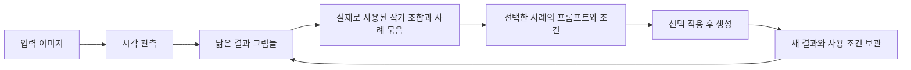

# Anima Library: 이미지로 유사사례를 찾고 작가 조합·프롬프트를 재사용하기

조사일: 2026-10-14, Asia/Seoul. 이 문서는 벤치마킹과 전체 설계 범위를 기록한다. 이미지 검색·사례 탐색·선택적 재사용의 첫 구현 및 실제 검증 범위는 [한국어 사용 안내](IMAGE_LIBRARY_KO.md) / [English](IMAGE_LIBRARY_EN.md)를 참고한다. 아래 설계 항목 전체가 구현된 것은 아니다.

사용자 보완 요구(2026-10-14): **이미지만 보고 유사사례를 찾는 기능이 첫 버전의 중심**이다.
핵심 흐름은 **이미지 → 비슷한 작가 조합의 결과 그림 → 연결된 프롬프트 → 조건 재사용**이다.
입력 이미지에 프롬프트·작가 태그·생성 메타데이터가 없어도 시작할 수 있어야 한다.
보관·검색·조건 재사용은 이 흐름을 뒷받침하며, 개인의 장기 취향 학습은 다음 단계로 유지한다.
이하의 순차 활성화는 구현할 동작의 설계이며, 네이티브 VRS 코어에서 이미 검증한 기능을 뜻하지 않는다.

## 1. 조사 범위와 판단 기준

일반 이미지 관리와 AI 생성 이력 관리를 함께 비교했다. 아래의 제품 기능은 공식 문서에서 확인한 내용이고,
Anima 적용안은 그 근거를 바탕으로 한 설계 판단이다. 동일 데이터셋으로 각 프로그램을 실행한 성능·사용성 실측은 아니다.
문서에서 확인하지 못한 기능을 미지원으로 단정하지 않는다. 제품의 처리속도 홍보 수치는 비교 점수로 사용하지 않았다.

평가할 사용자 작업은 다음과 같다.

1. 이미지 선택·드롭·붙여넣기만으로 시각적으로 닮은 사례를 찾는다.
2. 사례 그림을 보며 실제 사용된 작가 조합을 비교하고, 선택한 사례의 프롬프트·조건을 가져온다.
3. 기존 이미지 폴더와 앱 생성 결과를 보관한다.
4. 프롬프트·모델·Seed·태그·날짜를 조합해 다시 찾는다.
5. 자주 쓰는 프롬프트와 조건을 이름 붙여 관리한다.
6. 원본과 파생 결과, 수정한 조건을 비교한다.
7. 파일 위치가 바뀌거나 백업을 복원한 뒤에도 연결을 유지한다.

## 2. 제품별 확인 결과

| 대상 | 공식 자료에서 확인한 기능 | Anima에 적용할 설계 | 확인 범위·주의점 |
| --- | --- | --- | --- |
| Eagle | 태그, 폴더, 스마트 폴더, 별점, 메모, 일괄 작업, 중복 탐색 | 컬렉션·저장 검색·일괄 태깅을 같은 화면에 제공 | 생성 조건의 완전한 복원은 이번에 확인한 일반 정리 문서 범위 밖 |
| Diffusion Toolkit | PNGInfo 색인, 메타데이터 검색, 앨범, 프롬프트별 사용 횟수와 연결 이미지, NovelAI 등 지원 | 프롬프트를 별도 목록으로 탐색하고 해당 결과로 이동 | 공식 README는 Windows 전용이라고 명시. 외부 파일 이동 시 앱별 평점 등이 사라질 수 있다고 안내 |
| Infinite Image Browsing | 프롬프트·모델·LoRA 검색, 태그 자동완성, 이미지와 생성 정보 비교, 다른 생성 도구로 보내기 | 검색에서 조건 비교와 생성 화면으로 이어지는 흐름 | 공식 호환표에서 ComfyUI는 부분 지원. 지원 형식과 전체 설정 복원은 별도로 검증해야 함 |
| InvokeAI | 보드별 정리, Use Prompt / Use Seed / Use All, Seed를 제외하는 Remix, 저장 워크플로 불러오기 | 재사용 동작을 사용자의 의도에 맞춰 분리 | 생성 메타데이터가 있어야 가능한 동작이 있음 |
| Hydrus | 태그 조합 검색, 포함·제외, namespace, 자동완성, 별칭 관계 | 캐릭터·작품·스타일 등을 구분하고 별칭 검색 지원 | 직접 입력하는 고급 문법은 선택 기능으로 두고 기본 화면은 필터 버튼 제공 |
| digiKam | 내장 메타데이터와 XMP sidecar, 원본·중간 결과를 보존하는 버전 관리 | 원본 보존, 별도 관리 정보, 파생 관계와 이동·백업 설계 | XMP만으로 Anima 전체 생성 요청을 표현할 수 있는지는 별도 문제. 버전이 있는 생성 조건 형식 필요 |

제품별 근거:

- Eagle: [정리 기능](https://en.eagle.cool/support/desktop/organize), [Eagle 4 공식 소개](https://en.eagle.cool/blog/post/eagle4).
- Diffusion Toolkit: [개발자 README와 FAQ](https://github.com/RupertAvery/DiffusionToolkit).
- Infinite Image Browsing: [개발자 README](https://github.com/zanllp/infinite-image-browsing).
- InvokeAI: [Gallery Panel](https://invoke.ai/features/gallery/).
- Hydrus: [Tags](https://hydrusnetwork.github.io/hydrus/getting_started_tags.html), [Tag Siblings](https://hydrusnetwork.github.io/hydrus/advanced_siblings.html).
- digiKam: [Metadata Settings](https://docs.digikam.org/en/setup_application/metadata_settings.html), [Image Editor Settings](https://docs.digikam.org/en/setup_application/editor_settings.html).

가장 먼저 반영할 조합은 Eagle의 정리 방식, Diffusion Toolkit의 프롬프트 탐색,
InvokeAI의 선택적 조건 재사용이다. IIB의 비교 흐름, Hydrus의 태그 관계,
digiKam의 원본·버전 보존은 검색과 장기 보관의 기준으로 삼는다.

이미지 입력 흐름의 추가 벤치마크는 digiKam의
[Find Similar Image](https://docs.digikam.org/en/left_sidebar/similarity_view.html#find-similar-image)다.
앱 바깥의 이미지를 드롭해 내부 컬렉션의 유사 이미지를 찾고, 앨범 범위와 유사도 범위를 조정할 수 있다.
이 입력 방식을 참고하되, Anima에서는 결과 그림에서 실제 사용된 작가 조합과 프롬프트까지 이어지게 설계한다.
공식 문서의 이미지 검색 기능이 생성형 이미지의 화풍 구별 품질을 입증하는 것은 아니다.

특히 파일 경로가 바뀌면 분류 정보가 끊어지는 문제를 피해야 한다.
이미지의 안정적인 ID, 파일 내용 해시, 현재 파일 위치를 구분하고 위치 재연결을 지원하는 방향을 택한다.
같은 파일의 여러 사본, 같은 픽셀이지만 메타데이터가 다른 파일, 단지 비슷한 이미지는 별개 경우다.

## 3. 현재 Anima에서 재사용할 기반

조사 대상은 기존 0.5.0 작업본이다. 이 문서는 별도 신규 파일이며 기존 구현의 완성 여부나 배포 상태를 변경하지 않는다.
조사 시점의 브랜치는 `codex/nai-node-2.4.6-port`, HEAD는 `b363505`이며 기존 미커밋 변경을 포함한 작업 트리를 읽었다.
따라서 HEAD만으로 이 문서가 확인한 소스 전체를 재현할 수 있다고 가정하지 않는다.

| 현재 코드 | 확인한 동작 | 확장 지점 |
| --- | --- | --- |
| `src/anima_app/manifests.py`: `write_t2i_manifest` | 요청, 출력, 단계, variants, wildcard 선택, PNG 정보 저장 | Library에 생성 결과와 조건을 등록하는 입력 |
| 같은 파일: `read_t2i_history`, `_matches_history_query` | 매 조회마다 JSON 파일을 읽고 프롬프트·네거티브·모델·Seed·LoRA 등을 문자열 검색 | 증분 색인, 필드별 조건 검색, 대량 조회 |
| `src/anima_app/server.py`: `handle_history` | 검색 결과와 커서 기반 페이지 응답 | 기존 이력 호환 유지, 새 Library API |
| `src/anima_app/static/app.js`: `historyCard`, `openManifest` | 썸네일, 상세 보기, 내보내기, 결과 선택 | 컬렉션, 태그, 조건 비교, 일괄 작업 |
| 같은 파일: `applyPreset`, `applyManifest` | 저장 요청을 생성 화면에 적용 | 부분 적용, 적용 전 차이·누락 표시 |
| `src/anima_app/server.py`: preset 처리 | 프리셋 저장·가져오기·내보내기 | 이름·태그·판본과 연결 결과 탐색 |
| `src/anima_app/providers/novelai/metadata.py` | NovelAI 이미지 메타데이터 해석, 요청 정규화 | 외부 이미지 가져오기용 어댑터 |

기존의 이력·프리셋·메타데이터 복원 기반을 연결하면 된다.
전체 기능을 하나의 거대한 `server.py` 또는 `app.js` 함수에 추가하지 않고 Library 저장·검색·변환 코드를 분리한다.

## 4. 첫 버전의 사용자 경험

첫 화면의 주요 진입점은 **이미지로 찾기**다. 파일 드롭·붙여넣기·기존 이미지 선택을 지원한다.
기본 검색 범위는 사용자가 등록한 라이브러리와 연결한 사례 기억이다. 웹 전체 검색은 별도 범위다.
**이미지 / 프롬프트 / 생성 조건** 보기도 제공하여 같은 자료를 다른 관점으로 탐색한다.
이미지를 만들기 전에도 프롬프트와 생성 조건을 독립적으로 저장할 수 있어야 한다.

```text
이미지로 찾기         라이브러리 / 검색 범위 / 모델 / 태그
┌─────────────────┬─────────────────────────┬────────────────────────────┐
│ 기준 이미지     │ 비슷한 사례 그림들      │ 선택한 사례의 프롬프트     │
│ 드롭·붙여넣기   │                         │ 작가 조합·가중치 / 조건    │
│                 │ 조합 A+B: 결과 그림들   │                            │
│ 이 그림 기준    │ 조합 A+C: 결과 그림들   │ 작가 조합만 사용           │
│ 다시 찾기       │ 조합 미상: 결과 그림들  │ 프롬프트 / 조건 선택 적용  │
└─────────────────┴─────────────────────────┴────────────────────────────┘
```

작은 화면에서는 컬렉션과 상세를 접을 수 있는 패널로 제공한다.
키보드로 선택·이동·검색할 수 있고 태그나 상태를 색만으로 구분하지 않는다.

핵심 작업 예시:

1. 사용자가 메타데이터가 없는 이미지 한 장을 드롭한다.
2. 시각적으로 가까운 결과 그림들이 나타나고, 기록이 있는 사례는 사용된 작가 조합별로 비교할 수 있다.
3. 마음에 드는 사례·조합을 고르면 그 경로에 연결된 원본 프롬프트와 생성 조건이 열린다.
4. `작가 조합만 사용`, `프롬프트만 사용` 또는 `조건 선택`으로 다음 생성에 가져온다.
5. 바뀔 항목과 찾지 못한 모델·참조 파일을 확인하고 생성 화면에 적용한다.
6. 새 결과가 만들어지면 참고 사례, 선택한 조합과 조건 판본이 연결되어 다음 검색의 사례가 된다.

그림만 있는 사례도 검색에서 보이되 조합·프롬프트는 `기록 없음`으로 표시한다.
검색되는 사례의 이미지 파일·썸네일 위치를 연결해야 한다. 벡터만 있는 기억 패키지로 그림 미리보기를 복원할 수 없다.

조건을 불러오는 동작은 편집 중인 생성 요청을 갱신한다. 실제 생성은 기존 생성 버튼으로 시작한다.
`전체 불러오기`와 `Seed만 새로`를 구분한다. 같은 조건 복원이 픽셀까지 동일한 결과를 보장한다는 문구는 쓰지 않는다.

### P0: 첫 구현 범위

- 메타데이터 없는 입력 이미지로도 유사사례 조회. 입력에서 태그를 먼저 얻는 절차를 필수로 두지 않음.
- 유사한 결과 그림 → 그 사례의 작가 조합 → 실제 프롬프트·조건의 순차 탐색.
- 작가 조합별 사례 그림 비교, 조합 원문·순서·강조 구문·명시된 가중치 보존 및 선택 적용.
- 입력 이미지와 동일한 사본은 별도 표시하고 유사사례 순위를 사본으로 채우지 않음.
- 앱이 생성한 결과 자동 등록 + 사용자가 지정한 이미지/폴더의 가져오기.
- 외부 폴더는 기본적으로 원래 위치를 참조하고, 관리 폴더로 복사하는 선택 제공.
- 썸네일, 즐겨찾기, 수동 태그, 컬렉션, 일괄 분류.
- 프롬프트·네거티브·모델·Seed·provider·날짜·태그의 검색과 조합 필터.
- 프롬프트를 이름 붙여 독립 저장하고, 생성 조건과 그 결과를 연결.
- `프롬프트만 / Seed만 / 조건 선택 / 전체 / Seed만 새로` 적용.
- 메타데이터가 없는 이미지도 보관·시각 검색하고 수동 설명을 추가.
- 원본 기록, 사용자 수정, 자동 추정의 출처 구분.
- 앱 관리 대상은 휴지통을 거쳐 복원. 외부 참조는 우선 등록 해제로 처리.
- 지원되는 항목의 내보내기·다시 가져오기와 누락 표시.

최초 지원 형식은 Anima manifest와 NovelAI 메타데이터를 우선한다.
A1111과 ComfyUI는 지원 필드가 명시된 어댑터로 확장한다.
부분적으로 읽힌 외부 이미지는 보관을 허용하고 복원할 수 있는 항목만 표시한다.

### P1: 보관·재사용 완성도 확장

- 검색 조건 저장, 태그 별칭, 두 결과의 프롬프트·조건 차이 비교.
- 폴더 위치 재연결, 동일 파일 사본 관리, 가져오기 중단·재개.
- 프롬프트 조각과 조합, 프롬프트·조건 판본 비교.
- 전체 이미지 백업과 다른 장치로의 이전.

### P2: 개인 취향 학습·자연어 탐색

- 자연어 의미 검색, 개인의 장기 취향별 정렬·추천. 이미지 유사사례 조회는 P0에 포함한다.
- 저장·열람·실제 생성 사용·명시적 선호 평가를 구분한 입력 설계.
- 결과 저장이나 조회만으로 선호를 확정하지 않음.
- 추천 품질, GPU 자원, 기존 생성 작업과의 간섭을 별도로 평가.

## 5. VRS를 접목할 위치

첫 단계의 중심은 **입력 이미지가 관련 사례를 활성화하고, 그 사례의 조합과 프롬프트로 연결이 이어지는 것**이다.
출처·판본·보존 상태는 이 연결의 근거를 유지하는 기반이다.
화면에서는 `비슷한 그림`, `사용한 작가 조합`, `이 사례의 프롬프트`처럼 작업 의미를 드러내는 용어를 사용한다.



### 순차 활성화의 설계 계약

1. **이미지로 사례 활성화:** 입력 픽셀의 시각 관측으로 후보 결과를 찾는다. 입력 메타데이터 없이 작동한다.
   기본은 전체적인 닮음이며, 화풍·색감·구도별 제어는 실제 구별 품질을 검증한 범위에서 제공한다.
   같은 캐릭터나 구도만 닮은 사례가 화풍 후보를 독점하는지 별도로 평가한다.
2. **사례에서 조합 활성화:** 검색된 결과와 실제 생성 기록으로 연결된 작가 조합을 불러온다.
   조합은 작가 태그 하나씩의 투표 결과를 임의로 합친 목록이 아니다.
   A+B와 A+C는 서로 다른 사례 묶음으로 유지하고, A+B+C를 사용된 조합으로 만들어 내지 않는다.
   조합의 원문·태그 순서·가중치·provider·모델 조건을 보존하고 같은 이름의 다른 설정을 구분한다.
3. **선택 경로에서 프롬프트 활성화:** 사용자가 고른 사례·조합의 연결을 따라 원본 프롬프트와 조건을 조회한다.
   조합이 같은 여러 사례의 프롬프트는 선택지로 제시하며 자동으로 합치지 않는다.
   직접 입력 이미지의 정확한 원래 프롬프트를 알아냈다는 의미로 표현하지 않는다.
4. **선택으로 재탐색:** 사례 선택·제외는 현재 질의의 활성 경로를 좁힌다.
   첫 버전에서는 단순 열람을 영구 취향 학습으로 바꾸지 않는다.
5. **연결 근거 유지:** 각 단계는 입력·사례·조합·프롬프트 ID와 검색/파서 판본을 남긴다.
   관측된 연결, 사용자 등록 연결, 모델 추정 연결을 구분한다. 다른 그림의 출처 작가 태그만으로
   생성에 사용된 작가 조합을 확정하지 않는다. 원문에서 조합을 분리할 수 없으면 원문과 미확정 상태를 보존한다.

활성화는 질의마다 시작하고, 단계·후보 수를 제한해 순환 재전파와 중복 사례의 점수 부풀림을 막는 방향으로 설계한다.
이미지 유사도, 조합을 뒷받침하는 독립 사례 수, 모델 호환성은 서로 구별되는 정보다.
합산 점수를 작가 정답 확률이나 특정 조합이 화풍을 만들었다는 인과 증명으로 표시하지 않는다.
조합별 순위식·임계값과 네이티브 VRS 호출 계약은 아직 확정하지 않았으며 후속 구현·품질 평가가 필요하다.

자료를 다음처럼 분리한다.

| 개체 | 보존 내용 |
| --- | --- |
| 이미지 | 안정적인 ID, 파일 해시, 현재 위치들, 크기, 원본/파생 관계 |
| 프롬프트 판본 | 원문, 네거티브, 캐릭터별 프롬프트, 이름, 태그, 이전 판본 |
| 생성 조건 판본 | provider, 요청값과 실제 적용값, 모델 식별자·가능한 경우 해시, Seed, 샘플러, 참조 자산, 단계별 설정 |
| 실행 기록 | 사용한 조건 판본, 입력·마스크·참조 이미지, 결과, 성공·실패·부분 결과 |
| 관측 출처 | 이미지 메타데이터, 앱 manifest, 사용자 입력, 추정 모델과 그 판본 |
| 시각 관측 | 이미지 ID, 인코더·전처리 판본, 벡터 참조, 색인 상태 |
| 작가 조합 판본 | 실제 프롬프트 구간, 태그 순서·강조 구문·명시 가중치, provider·모델, 이를 사용한 결과·프롬프트 참조 |
| 탐색 경로 | 질의 이미지, 활성화된 사례, 조합, 선택된 프롬프트, 단계별 근거와 선택 상태 |
| 분류 | 컬렉션, 수동 태그, 별점, 저장 검색, 삭제·복원 상태 |

메타데이터의 “빨간 옷”은 생성 당시 요청이다. 실제 이미지가 빨간 옷이라는 검증 결과로 바꾸지 않는다.
정보가 없으면 `알 수 없음`, 서로 다르면 출처별 값을 보존한다.
이름 후보나 추정 태그가 원문을 덮어쓰지 않도록 한다.

### 기존 VRS-INT에서 확인한 재사용 후보

로컬 RS-Seasonal-Prompt-Generator의 `vrs_int/` 소스와 문서를 대조했다.
조사 시점의 브랜치는 `codex/complete-prompt-generator`, HEAD는 `75b16cc`다.

- `generation_metadata.py`, `generated.py`: 생성 메타데이터 해석과 가져오기.
- `store.py`와 README: 해시 기반 스냅샷, 검증, 내보내기·설치·활성화 경로.
- `GENERATION_STATE.md`: 선택한 재료의 출처와 조건을 정리하는 방식.
- `recommend.py`: 입력 이미지 인코딩, 호환 스냅샷의 시각 이웃 조회, 이웃 ID와 태그별 지지 관측 반환.
  현재는 코사인 유사도로 이웃을 고른 뒤 개별 태그에 투표하는 구조다.
- `state_selection.py`: 선택한 참조 사례의 공출현 태그를 유지하는 보수적 선택 경로.
  작가 조합별 그림 탐색과 원본 프롬프트 연결의 완성 구현은 아니다.

이 VRS-INT 저장·검색 경로는 문서상 **네이티브 VRS 판정 코어를 호출하지 않는다**.
따라서 앱 Library 어댑터 추가와 네이티브 코어 통합은 별도 구현이며, 이미 연동되어 있다고 표현하지 않는다.
`activation_memory.py`는 모델 FFN 입출력 상태를 재사용하는 별도의 실험이다.
이번 이미지 → 사례 → 작가 조합 → 프롬프트의 순차 탐색이 그 파일에 구현되어 있다고 해석하지 않는다.

현재 파서를 전체 조건 백업으로 직접 사용하는 것은 충분하지 않다.

- `generation_metadata.py`의 `SETTINGS`는 일부 설정만 보존하는 목록이다.
- ComfyUI `CharacterPromptSelect` 처리는 현재 코드에서 1~8 슬롯을 순회한다.
  Anima가 다루는 더 많은 슬롯 및 provider별 조건 전체가 이 경로로 보존된다고 가정할 수 없다.
- `generation-state`는 추천 재료를 창작 상태로 정리하는 실험 경로다. 과거 실행의 완전 복원 형식이 아니다.
- VRS 기억 패키지에는 원본 이미지 픽셀이 포함되지 않는다. 메타데이터 내보내기와 이미지 백업을 구분해야 한다.

따라서 **Anima의 전체 생성 조건 판본을 먼저 보존하고**, 그 판본을 VRS 관측과 연결하는 어댑터를 설계한다.
기존 VRS-INT의 제한된 검색용 자료로 원래 생성 요청을 대체하지 않는다.
벡터 구축과 이미지 검색에는 현재 CUDA 관련 의존성이 있다.
보관·일반 검색·복원과 실행 경로를 분리하되, 이미지 검색은 첫 버전의 핵심 기능으로 유지한다.
호환 인코더·스냅샷·장치가 없으면 준비 상태를 명시한다. 태그 검색 결과를 이미지 검색 성공으로 대신 표시하지 않는다.
CPU 대체 경로와 대규모 검색 가속은 현재 구현되어 있다고 가정하지 않는다.

## 6. 구현 원칙

- 로컬 SQLite에 검색 가능한 정규화 자료와 관계를 저장한다. FTS 및 구조화 필터는 별도 색인으로 둔다.
  한국어 부분 일치와 태그 별칭은 사용할 tokenizer 및 검색 규칙을 검증한 뒤 확정한다.
- 파일명이나 경로를 이미지의 유일한 ID로 사용하지 않는다. 경로가 바뀌어도 동일 파일을 재연결한다.
  파일 해시와 픽셀 유사도는 의미가 다르므로 자동 병합 기준을 섞지 않는다.
- 저장한 생성 조건 판본은 불변으로 두고, 수정 시 새 판본과 변경 관계를 만든다.
- 원본 프롬프트, wildcard 입력과 실제 확장 결과, 요청 설정과 실제 적용 설정을 함께 보존한다.
- inpaint 마스크, img2img 입력, Vibe/Precise 참조, LoRA, 캐릭터 슬롯 및 단계별 결과를 자산 참조로 연결한다.
  없는 자산은 `누락`으로 표시하고 전체 복원 성공으로 세지 않는다.
- provider가 다르면 지원되는 항목만 적용하며, 무시되거나 변환되는 항목을 사용자에게 보여준다.
- 원본 metadata가 충돌하면 출처별 주장을 남기고 선택한 해석에 파서 판본을 기록한다.
- 파일 감시는 변경 힌트로 사용한다. 재스캔과 재시도가 동일 자료를 중복 등록하지 않도록 한다.
- Library 저장 트랜잭션에 동기화할 작업을 함께 기록하고, 검색 색인·VRS 스냅샷 갱신을 재시도 가능하게 한다.
  갱신 완료 전후 상태를 구분하고 잘못된 최신 스냅샷을 노출하지 않는다.
- 큰 가져오기 작업은 진행 상태·취소·재개를 지원한다. 썸네일과 검색 색인은 재생성 가능한 자료로 취급한다.
- 비밀 토큰은 조건·프리셋·메타데이터·내보내기에 포함하지 않는다.
  참조 이미지를 포함하는 공유 묶음은 포함 항목을 표시하고 사용자 자료를 공개 코드에 넣지 않는다.

## 7. 실측 벤치마크와 수용 기준

아래는 **실행 전 검증 계획**이다. 처리 시간과 성공률은 아직 측정하지 않았다.
각 제품은 설치 버전·OS·스토리지·설정·입력 형식에 따라 별도 결과를 기록한다.

공통 기능 자료는 개인 파일 대신 합성 이미지와 알려진 생성 정보를 사용한다.
시각 검색 품질에는 사용이 허용된 실제 시각 평가 자료도 필요하다. 학습·색인 사례와 평가 질의를 분리하고,
동일 이미지 및 재압축·리사이즈 사본이 양쪽에 섞여 품질이 부풀려지지 않게 한다.
같은 인물/다른 화풍, 다른 인물/유사 화풍, 유사 색감/다른 구도 등을 포함하여 사람이 평가한 관련 사례를 준비한다.
작가 조합 문자열 일치와 시각적 관련성은 별도로 평가하며, 합성 연결 검사만으로 화풍 검색 품질을 통과시키지 않는다.
Anima, NovelAI, A1111, 지원 가능한 ComfyUI 그래프, 메타데이터 없음, 손상 메타데이터,
동일 파일 사본, 동명이파일, 이동한 파일, 누락 참조, 다중 캐릭터, 후처리 결과를 포함한다.
일반 관리 도구에는 공통 태그·분류 작업을, 생성 도구에는 해당 프로그램이 해석하는 형식의 복원을 평가한다.
지원하지 않는 형식은 성능 실패와 구분해서 기록한다.

| 시나리오 | 기록할 지표 | Anima 첫 버전 수용 기준 |
| --- | --- | --- |
| 이미지 단독 질의 | 메타데이터 제거 전후 결과, 단계별 지연 | 디코딩한 픽셀이 같으면 고정된 색인·설정에서 시각 후보 순위 동일, 입력 프롬프트 불필요 |
| 시각적 유사사례 품질 | 사람 평가 기준 Hit@10·nDCG@10, 화풍/내용별 오검색 | 사본 찾기와 화풍 탐색을 분리 보고. 합격 수치는 평가 자료·관련성 기준과 함께 사전에 확정 |
| 작가 조합 사례 연결 | 원본 구문·순서·가중치, 출처와 독립 사례 수 | 실제 사용 기록 없는 조합을 관측된 조합으로 표시하는 건수 0 |
| 순차 경로 선택 | 입력 → 사례 → 조합 → 프롬프트 참조 | 선택된 경로와 무관한 프롬프트 적용 0, 연결 정보 누락 명시 |
| 검색 준비 및 실패 | 인코더·색인·장치 부재, 취소 상태 | 미준비·실패·검색 결과 없음 구분, 부분 결과 상태 명시 |
| 최초 가져오기와 반복 가져오기 | 소요 시간, 진행 표시, 중복 수, 취소 후 상태 | 재실행 후 중복 등록 0, 원본 파일 변경 0 |
| 프롬프트+모델+Seed 검색 | 정답 포함·제외, 초기/반복 검색 p50·p95 | 알려진 자료의 정답 일치, 누락 필드를 임의 채우지 않음 |
| 일반 검색의 자원 사용 | CPU·메모리·GPU·외부 요청 | GPU 모델 로드와 외부 API 호출 0 |
| 선택적 조건 불러오기 | 변경 항목, 클릭 수, 수동 보정 수 | 선택한 필드만 변경, 생성 API 호출 0 |
| 전체 조건 왕복 | 내보내기 → 가져오기 → 편집 화면 비교 | 지원 필드 보존, 누락·불일치 전부 표시 |
| 참조가 필요한 생성 | 모델·입력·마스크·참조 유무 | 빠진 항목을 전체 복원 가능으로 표시하지 않음 |
| 이동과 재연결 | 즐겨찾기·태그·조건 연결 유지 | 정확히 동일한 파일의 재연결 후 관리 정보 유지 |
| 삭제와 복원 | 원본·사본·등록 상태 | 외부 참조 등록 해제로 원본을 삭제하지 않음 |
| 이미지 포함 백업 복원 | 파일 해시, 개수, 관계, 프롬프트 판본 | 묶음에서 보장한 범위의 해시와 관계 일치 |
| 색인 갱신 중 중단 | 재시도 결과, 최신 상태 표시 | 미완료 상태를 성공으로 표시하지 않으며 재시도로 복구 |

규모 시험은 1천 → 1만 → 10만 항목 순서로 늘려 첫 화면, 검색, 썸네일 캐시,
추가 100건의 증분 갱신을 측정한다. 각 단계에서 초기와 캐시가 있는 경우를 나누고 동일 조건을 기록한다.
실측 전 임의의 “몇 ms” 약속이나 타 프로그램 대비 배속은 제시하지 않는다.

## 8. 구현 순서와 이번 산출물의 경계

1. 이미지·시각 관측·작가 조합·프롬프트·생성 조건과 각 연결의 저장 계약을 정하고 사례를 등록한다.
2. 입력 이미지 하나로 실제 사례 그림을 찾는 작은 실행 경로와 시각 품질 평가를 먼저 만든다.
3. 사례 → 실제 작가 조합 → 프롬프트의 순차 활성화와 선택 화면을 연결한다.
4. 작가 조합·프롬프트·조건의 선택 적용 및 누락 자산·provider 호환성 표시를 완성한다.
5. 보관·분류·일반 검색, 판본 연결, 내보내기·복원 및 VRS 연계 어댑터를 통합해 P0를 검증한다.
6. 실제 작업 흐름·규모 시험 후 P1을 확장하고, P2에서 장기 취향 학습과 자연어 탐색을 다룬다.

이번 산출물은 비교 근거, 로컬 구현 현황, 첫 버전의 범위와 검증 계획이다.
프로그램을 설치해 비교 실행하거나 앱 기능을 구현한 결과가 아니며, 공개·배포·실제 이미지 생성은 포함하지 않는다.

## 9. SD Studio 분석을 통한 후속 기능 후보 — 2026-10-14

### 9.1 근거와 현재 상태

이 절은 기존 `SDStudio-analysis/report.html`, `evidence/source-features.json`,
`evidence/source-maintenance.json`, `evidence/rea-analysis-summaries.json`을 재사용하고,
SD Studio와 Anima의 현재 로컬 소스를 대조한 후속 제안이다. 앞 절의 최초 조사 시점과 구분한다.
현재 구현 범위와 설정은 [이미지 라이브러리 가이드](IMAGE_LIBRARY_KO.md)에 있다. 개인 데이터셋의 경험 확장 결과는 배포하지 않는다.

- SD Studio 분석 대상: `sunho/SDStudio` 커밋 `f2088add103ad683a31e0590448e6e5bb4d71556`.
  [3.1.11 릴리스](https://github.com/sunho/SDStudio/releases/tag/3.1.11)의 커밋은
  `1587751dc66bd53a8397d4b9c23e9e83fba1e80c`이다. 두 커밋 자체가 같다는 뜻은 아니다.
- 기존 검증 결과는 패키지 무결성·소스 대응 141개 검사 통과와 소스맵 항목 64개의
  줄바꿈 정규화 후 일치를 기록한다. 이번에는 분석에서 해시를 보관한 소스 48개가
  현재 파일과 일치함을 다시 확인했다. 141개 전체 검사를 이번에 재실행한 것은 아니다.
- 보관된 REA 분석 parent Evidence:
  `ev_710be28a4cdb2b45e828c6e973031eae58bbbabeee1ee71b4717db86d8ccc5ae` (desktop boundary),
  `ev_fbe1063e7bf5346fa9ecd0fc880de5e43a1a32e08aa4680d298d4448e192210d` (recovered desktop boundary).
  아래 기능 근거는 별도 소스 추적 기록의 `F01`–`F11`, 제한은 `L01`–`L07`이다.
  REA 경계 분석만으로 모든 UI 동작이 실행 검증됐다고 해석하지 않는다.
- Anima 대조 대상: `codex/nai-node-2.4.6-port`, 기반 HEAD `b363505` 위의 현재 작업 파일.
  라이브러리를 포함한 미커밋 변경이 있으므로 HEAD만으로 이 상태를 재현할 수 없다.
- 이번 확인은 저장 자료·소스·기존 README 화면에 대한 조사다. SD Studio 실행이나
  NovelAI 생성 요청, Anima 동작 변경은 수행하지 않았다.

### 9.2 본받을 기능과 구현 격차

| 우선순위 | SD Studio에서 확인한 기능 | Anima의 현재 기반 | 가져올 확장 |
| --- | --- | --- | --- |
| 1 | 두 그림씩 고르는 월드컵, 둘 다 선택/제외, 실행취소, 갤러리 순위 (`F08`, `F09`) | 한 생성물의 처리 단계 비교 및 검색 결과별 닮음·재사용 평가 | 기준 그림을 유지한 후보 A/B 비교, 채택·보류·제외, 비교 진행과 선택 이력 보존 |
| 2 | 씬별 프롬프트·해상도·후보·대표 이미지 보유 (`F01`, `F04`, `F09`) | 이미지별 단일 컬렉션 문자열, 검색 이력, 전체 생성 이력 | 기준 이미지·검색 결과·조합·프롬프트·실험 결과를 묶는 작업 보드와 여러 보드에 사례 연결 |
| 3 | 이름 있는 프롬프트 조각, 모음 참조, 랜덤 대안 (`F05`) | 파일 기반 와일드카드·프롬프트 프리셋·조건 프리셋·확장 미리보기 | 대표 그림과 사용 사례를 붙인 작가 조합/프롬프트 카드, 이름·설명·판본·부분 삽입 관리 |
| 4 | 슬롯별 선택지의 전체 조합과 앞/중간/뒤 프롬프트 합성 (`F06`, `F07`) | 반복 생성·시드 방식·와일드카드 전개 | 조합 실험표: 작가 조합 × 장면 × 시드 목록, 실행 전 최종 프롬프트·장수 미리보기 |
| 5 | 씬별 대기량·진행·시간 추정 (`F02`, `F03`) | 서버 큐, 반복 횟수·지연·취소, 현 서버 큐에 UI 재접속 | 보드별 작업 현황과 항목 관리, 저장 가능한 작업 상태 및 서버 재시작 복구 |
| 6 | 레시피만 내보내기와 이미지 포함 프로젝트 백업 (`F10`, `F11`) | 조건 프리셋 JSON 내보내기·가져오기 | 레시피 공유와 원본·참조·마스크·선택 이력을 포함하는 작업 보드 백업 구분 |

Anima 근거: `src/anima_app/static/library.js:82,114,126,147`,
`src/anima_app/library.py:58,74,237,275,303`, `src/anima_app/wildcards.py:51,73`,
`src/anima_app/static/app.js:519,1755,2087,3012,3155`, `src/anima_app/server.py:2061,2225`.
조사한 라이브러리·웹 UI·서버 저장 모델에서는 독립 작업 보드, 임의 후보 간 순위 선발,
프롬프트 조각 관리 화면, 서버 프로세스 재시작용 큐 저장을 확인하지 못했다.

### 9.3 VRS에 맞춘 사용 흐름

`기준 이미지 → 유사사례 → 두 후보 비교 → 작가 조합 카드 → 조건을 고정한 실험 → 결과 채택`

SD Studio의 월드컵은 후보 중 원하는 결과를 고르는 기능이다. Anima에서는 비교 목적을
명시하여 **기준 이미지와 더 닮음**과 **개인적으로 더 마음에 듦/재사용하고 싶음**을 구분한다.
화풍 검색 평가에서는 기준 이미지를 계속 보여주고, 필요하면 화풍·색감·구도 기준을 선택한다.
비슷하지 않음, 동률, 판단 불가를 구분해 기록하며 항상 한 장을 강제로 고르게 하지 않는다.

현재 Anima의 `visual`·`reuse` 피드백은 저장만 한다. 검색은 이미지 벡터 내적 순위이며,
피드백 응답도 `training: false`다. 경험 이미지 수 증가, 비교 판단 기록, 순위 보정,
인코더 학습을 각각 구분한다. 비교 기능을 붙인 것만으로 검색기가 학습됐다고 표시하지 않는다.
우선 비교 기록을 평가 자료로 사용하고, 질의 단위 순위 보정은 별도의 구현·검증 대상으로 둔다.

비교 이벤트에는 질의 ID/기준 이미지 참조, 두 후보 자산 ID와 당시 생성 기록 ID,
비교 기준·선택·되돌리기 관계, 검색 계약/색인 판본을 보존한다. 외부 업로드 질의는 현재
해시만 기록하므로 보드를 다시 열 때 기준 그림도 복원하려면 관리용 사본 보존이 추가로 필요하다.
검색 순위를 뒤늦게 바꿔도 당시 선택의 근거를 잃지 않게 한다.

작가 조합 카드는 관측된 작가 순서·가중치와 모델, 원본 프롬프트 판본, 출처 사례를 연결한다.
카드에 보이는 화풍이 작가 태그만의 효과라는 보장은 하지 않는다. 같은 캐릭터·장면·모델·시드
목록에서 조합만 바꿔 비교하면 영향을 평가하기 쉬워진다. 예를 들어 조합 4개 × 장면 3개 ×
시드 2개라면 24장을 미리 표시한다. 실제 생성은 기존 생성 실행 동작과 비용 보호를 따른다.

현재 `animaLibraryApply`는 생성 폼 값을 바꾸지만 원래 사례·조합 선택을 새 생성 결과의
부모 관계로 남기지 않는다. 보드에서 채택한 `record_id`, 적용한 범위, 수정 내역과 실제 요청
스냅샷을 다음 생성 manifest에 연결하는 것이 경험 순환을 완성하는 추가 설계다.
이는 SD Studio에서 VRS 학습을 확인했다는 주장이 아니라 두 프로젝트를 대조한 제안이다.

### 9.4 구현 시 보완할 점과 다음 단위

- SD Studio의 비교 UI는 참고하되 매 선택·실행취소를 명시적으로 저장한다.
  기존 분석 `L05`는 매 클릭 자동 저장이 확실한지 검증이 필요하다고 기록한다.
- 프롬프트 전체 조합은 예상 건수를 먼저 계산하고 상한·분할 실행을 둔다.
  랜덤 확장은 시드와 최종 프롬프트를 기록하여 재시도 때 다른 요청이 되지 않게 한다 (`L03`, `L04`).
- 큐 진행 UI와 큐 복구 보장을 구분한다. SD Studio의 메모리 큐·중단 처리를 그대로
  복구 모델로 사용하지 않고, 이미 완료한 생성의 재요청 여부를 판정할 기록을 둔다 (`L01`, `L02`).
- 보드 백업은 저장 시점의 일관된 스냅샷과 자산 목록·해시·누락 상태를 검증한다 (`L06`).

첫 구현 후보는 **검색 결과를 비교하고, 기준 그림·후보·선택을 작업 보드에 저장해 다시 여는 흐름**이다.
기존 유사 검색과 생성 조건 적용은 재사용한다. 수용 기준은 재접속 후 기준 이미지와 비교
진행 복원, 선택/동률/보류/실행취소 보존, 사례의 정확한 프롬프트 연결, 평가 저장만으로
생성 API를 호출하지 않는 것이다. 다음으로 조합 카드와 통제된 실험표를 연결한다.
이 절은 기능 선정과 설계이며 해당 확장 기능의 구현 완료를 의미하지 않는다.

## 10. SD Studio UI 벤치마킹과 Anima 화면 시안

2026-10-14 추가. 기능의 유무에 더해 **그림을 보는 면적, 비교하는 동안 유지되는 맥락,
선택한 기록을 다음 작업으로 옮기는 동작**을 비교했다. 결과는 아래의 제안이며,
클릭 가능한 [독립 HTML 시안](ui-library-concept.html)을 함께 제공한다.

### 10.1 확인 범위와 근거

SD Studio의 저장 분석과 공개 소스를 대조했다. 개인 분석 보고서는 배포 문서에 포함하지 않는다. 공개 근거는 [SD Studio 저장소](https://github.com/sunho/SDStudio)에서 확인할 수 있다.
이번 UI 검토에서는 저장소 `images/`의 README 화면과 해당 컴포넌트를 직접 확인했다.
README 화면은 촬영 시점과 현재 실행 상태가 알려지지 않은 참고 자료다.
SD Studio를 이번에 실행하거나 성능을 측정한 것은 아니다.

| 근거 | 실제 확인한 자료 | 확인할 수 있는 범위 |
|---|---|---|
| UI-S01 | SDStudio `images/img1.png`, `img3.png`; `App.tsx:240`, `App.tsx:286` | 프롬프트/스타일과 씬 카드가 나란히 배치됨. 생성·변형·조각 탭. 하단 프로젝트와 작업 큐 |
| UI-S02 | `images/img2.png`; `ResultViewer.tsx:431`, `ResultViewer.tsx:1148` | 큰 결과 갤러리, 크기 선택, 컨테이너 크기에 따른 열 수, 가상 목록 렌더링 |
| UI-S03 | `images/img8.png`; `Tournament.tsx:208` | 두 그림을 크게 나란히 보여주는 비교 화면, 실행취소, 둘 다 승리·패배 |
| UI-S04 | `images/img10.png`, `img111.png`; `PromptEditTextArea.tsx:449`, `PromptEditTextArea.tsx:521` | 자동완성·조각 강조·키보드 선택. 한국어 표기가 포함된 자동완성 화면 |
| UI-S05 | `FloatView.tsx:77`; `ResultViewer.tsx:583`; `TaskQueueControl.tsx:72` | Escape/방향키로 상세 탐색, 남은 작업 수·예상 시간 표시 |
| UI-A01 | 현재 Anima `http://127.0.0.1:8768/`의 1440×1000 새 브라우저 화면 | 실제 메인·라이브러리·첫 사례 선택 화면, API GET만 허용한 관찰 |
| UI-A02 | Anima `src/anima_app/static/library.js:5`, `:56`, `:105`, `:164`, `:201` | 카드/상세 크기, 버튼·설정 배치, 적용 후 대화상자 닫기, 현재 상태 표시 |

위 SD Studio 컴포넌트 중 `App`, `ResultViewer`, `Tournament`, `TaskQueueControl`,
`PromptEditTextArea`, `FloatView`, `PreSetEdtior` 7개는 로컬 파일의 SHA-256을 기록하고
기존 릴리스 복원 소스와 CRLF/LF 정규화 후 일치하는 것을 확인했다.
이는 소스 대응 확인이며, 실행 결과나 README 스크린샷의 버전을 확정하는 검증은 아니다.
파일 이름 `PreSetEdtior.tsx`와 디렉터리 `componenets`는 원본 철자다.

### 10.2 현재 화면에서 확인한 불편과 가져올 패턴

| 관찰 | Anima에 적용할 화면 규칙 | 우선순위 |
|---|---|---|
| 현재 메인도 이미 생성 제어·결과·이력 3열이다. 라이브러리는 이력 쪽 버튼으로 여는 별도 대화상자다 | 라이브러리를 주요 작업 화면으로 올리고 탐색·비교·프롬프트 사이에서 기준 그림, 선택, 스크롤, 작성 내용을 보존 | P0 |
| 1440×1000에서 첫 카드 시작점이 y=479.8px. 상단 통계·설명·검색 방식·파일 입력·가져오기·검색 폼이 높이를 차지 | 최초 화면부터 기준 그림과 후보가 보이게 하고 가져오기/색인/고급 설정은 별도 접기 영역이나 관리 화면으로 이동 | P0 |
| 카드 그림은 높이 150px, 상세는 최대 260px. 긴 작가 목록이 여러 줄로 카드 높이를 차지 | 썸네일 크기 선택, 기본 전체 그림 표시, 작가 이름 요약, 선택 시 전체 순서·가중치 표시, 큰 그림 보기 | P0 |
| 파일 입력으로 질의하지만 결과 옆에 입력 그림을 유지하는 요소가 없다 | 기준 그림을 별도 패널에 유지. 비교 모드에서도 기준과 두 후보를 함께 표시 | P0 |
| 작가/프롬프트/조건 적용 버튼은 이미 있지만 적용하면 라이브러리가 닫힌다 | 선택 사례와 원문을 오른쪽에 유지하고 작업 단계만 전환. 추가·교체 구분 및 되돌리기 제공 | P0 |
| 상태에는 VRS 색인 2,000장이 표시되는데 검색 선택지에는 항상 '색인 준비 필요'라고 적혀 있다 | '이미지로 찾기'를 기본 진입점으로 두고 실제 상태에 맞춰 준비됨·준비 중·실패를 표시. 검색 방식 상세는 고급 설정으로 이동 | P0 |
| SD Studio는 씬마다 대표 그림과 개수를 보여 준다 | 작업 보드와 작가 조합도 대표 그림·사례 수·짧은 이름으로 진입. 사용자가 긴 프롬프트를 읽기 전에 그림으로 선택 | P1 |
| SD Studio는 프롬프트 조각과 자동완성을 시각적으로 구분한다 | 작가 조합·장면·캐릭터 등의 조각을 구분하고 원문 편집으로 전환 가능하게 설계. 토큰 순서·가중치는 그대로 보존 | P1 |
| SD Studio는 하단에 큐 진행을 유지한다 | 화면 전환 중에도 진행·대기·오류와 중단 경로를 찾기 쉽게 유지. 검색 진행과 생성 진행은 별도로 표시 | P1 |

SD Studio의 큰 갤러리와 선택 흐름을 참고하되 아이콘만으로 구성된 동작은 짧은 이름과 함께
보여 준다. 그림 비교에서 크롭으로 중요한 부분이 잘리지 않게 기본은 전체 맞춤이며,
확대·이동은 별도 동작으로 둔다. 유사도 수치를 확률처럼 표현하지 않고 순위와 판단 기록을
중심으로 보여 준다. 도구 설명과 생성 엔진 설정은 필요한 순간에 접근할 수 있도록 배치한다.

### 10.3 제안하는 탐색 화면

데스크톱의 기본은 **왼쪽 기준 그림과 보드 / 중앙 사례 또는 비교 / 오른쪽 선택 기록**이다.
전체 앱을 항상 세 열에 고정하는 규칙은 아니다. 비교할 때는 중앙을 두 후보에 집중시키고,
생성할 때는 프롬프트와 결과를 중심으로 바꾸되 기준 그림·출처 연결·입력 초안을 유지한다.

- **탐색:** 외부 그림 또는 기존 사례에서 시작 → 큰 결과 카드 → 선택 기록 확인.
- **비교:** 기준 그림 고정 → 후보 A/B → 닮음 판단, 둘 다 비슷함·다름·보류·되돌리기.
- **프롬프트:** 선택한 사례의 조합 추가 또는 원문 가져오기 → 내 프롬프트 편집 → 검색으로 복귀.
- **작업 보관:** 기준 그림·후보·판단·프롬프트 초안을 보드 단위로 다시 열기. 이 단계는 별도 구현이 필요하다.

왼쪽은 약 220–260px, 오른쪽은 약 300–360px를 기준으로 중앙 갤러리에 남은 폭을 배분한다.
좁은 화면에서는 상세 패널을 접거나 아래로 보내며, 실제 통합에서는 모바일 비교에도
기준 그림을 다시 볼 수 있는 축소 고정 영역과 포커스 복귀가 필요하다.

### 10.4 클릭 가능한 시안과 검증

`docs/ui-library-concept.html`을 브라우저에서 열면 된다. 외부 라이브러리나 서버가 필요 없다.
화면 구조를 판단하기 위한 가상 풍경 SVG 6개와 `artist:sample_*` 기록만 포함한다.
실제 이미지·작가 추천 결과를 표현한 시안이 아니다.

직접 조작할 수 있는 항목은 카드 선택, 기록 확인, 카드 크기, 이름 필터, 큰 그림 보기,
기준 그림 로컬 미리보기, 비교 판단/실행취소, 조합 추가, 프롬프트 전체 가져오기와 되돌리기다.
탐색과 프롬프트 단계를 오가도 편집 중인 초안은 해당 페이지 세션에 유지된다.
기준 그림을 바꿔도 예시 후보는 그대로이며 네트워크 검색이나 색인을 실행하지 않는다.
새로고침 후 복원, 보드 DB 저장, 실제 VRS 검색, 실제 생성은 연결하지 않았다.

Playwright Chromium에서 다음을 확인했다.

- 선택한 사례의 조합과 원문 연결, 조합 추가 시 기존 초안 보존.
- 단계 전환 시 편집 내용 유지, 전체 프롬프트 가져오기 후 되돌리기.
- 비교 판단과 취소, 이미지 확대창 Escape, 필터/빈 결과, 크기 변경.
- 화면 폭 1920 / 1280 / 900 / 390px에서 문서 가로 넘침 없음.
- 위 점검 중 JavaScript 오류 0건, 외부 네트워크 요청 0건.

동일한 1440×1000 시안에서 첫 카드 시작점은 y=275.4px였다. 현재 앱의 y=479.8px와
비교하면 후보가 약 204px 위에서 시작한다. 표시 데이터와 기능 밀도가 다른 시안의 배치
비교이므로 실제 검색 속도, 업무 시간, 사용자 만족도 개선 수치로 해석하지 않는다.

실제 통합의 수용 기준은 ① 기준 그림 유지 ② 선택/스크롤/초안 복귀 ③ 원문과 표시 요약의
일치 ④ 키보드 선택·닫기·포커스 복귀 ⑤ 가져오기 전후 변경과 실행취소 ⑥ 누락 기록과
검색 실패·로딩·빈 결과 구분 ⑦ 실제 2,000장 목록의 응답성과 점진적 렌더링이다.
시안 6개에 대한 점검은 2,000장 통합 성능을 검증하지 않는다.

이번 변경은 벤치마킹 문서와 독립 UI 시안이다. 앱 UI·검색 로직에 적용한 상태가 아니다.
검증 자료는 Git 제외 로컬 디렉터리 `outputs/ui-benchmark-20261014/`에 보관했다.

- `anima-current-main.png`, `anima-current-library.png`, `anima-current-detail.png`
- `concept-discover.png`, `concept-compare.png`, `concept-compose.png`, `concept-mobile.png`
- `current-observation.json`, `concept-validation.json`, `sdstudio-ui-source-evidence.json`


## 2026-10-14 구현 반영: 이미지 작업실

UI 시안의 핵심 탐색 흐름을 실제 앱에 연결했다. 기준 그림 고정, 화면 전체 갤러리와 크기 조절, 기록 상세, 조합 필터와 검색 복귀, 기준 그림 아래 후보 A/B 비교와 취소, 원본 기반 확대, 초안 가져오기·수동 편집·되돌리기·생성 폼 적용을 구현했다. 비교 평가는 같은 검색 결과만 허용하고 기존 닮음/재사용 평가와 분리 저장한다. 초안은 현재 페이지 세션 동안 유지된다.

영구 작업 보드, 대표 이미지를 고르는 독립 작가 조합 카드 관리, 조합별 생성 실험, 생성 결과 부모 계보, 비교 평가에 따른 순위 학습은 후속 범위다. 현재 UI에 미완료 기능의 가짜 버튼이나 가상 생성 진행을 넣지 않았다.

현재 사용법은 [한국어 라이브러리 가이드](IMAGE_LIBRARY_KO.md#이미지-작업실-ui-2026-10-14), [English](IMAGE_LIBRARY_EN.md#integrated-image-workspace-2026-10-14)에 기록했다. 통합 동작·합성 브라우저 검사와 패키징 검증의 범위는 [메인 업데이트](MAIN_UPDATE_2026-10-14.md)를 참고한다. 개인 검색 결과와 실행 자료는 Git 제외 경로에 보관하고 공개 문서에 포함하지 않는다.
